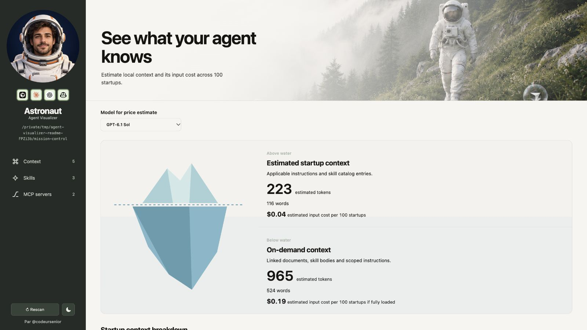

# Product Engineer Kit

**Des outils et des skills pour comprendre votre code et mieux travailler avec vos agents IA.**

| Skill                                                 | À quoi il sert                                                       |
| ----------------------------------------------------- | -------------------------------------------------------------------- |
| [PEK Ingest](skills/pek-ingest/README.md)             | Conserver les décisions utiles dans le contexte du projet.           |
| [PEK Root Cause](skills/pek-root-cause/README.md)     | Retrouver la cause d’un bug avant de proposer une correction.        |
| [PEK Grill Me](skills/pek-grill-me/README.md)         | Clarifier une idée, une question à la fois.                          |
| [PEK Auto Improve](skills/pek-auto-improve/README.md) | Transformer les corrections d’une session en améliorations durables. |

[Agent Visualizer](packages/agent-visualizer/README.md) · [Les skills sur skills.sh](https://skills.sh/codeursenior/product-engineer-kit) · [YouTube CodeurSenior](https://www.youtube.com/@CodeurSenior)

Pour progresser en Product Engineering et mieux défendre vos décisions techniques, [rejoignez ma newsletter](https://codeursenior.substack.com/).
